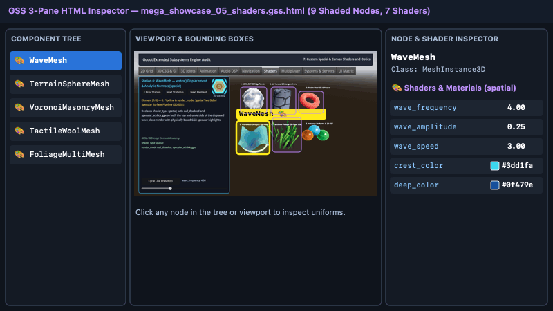
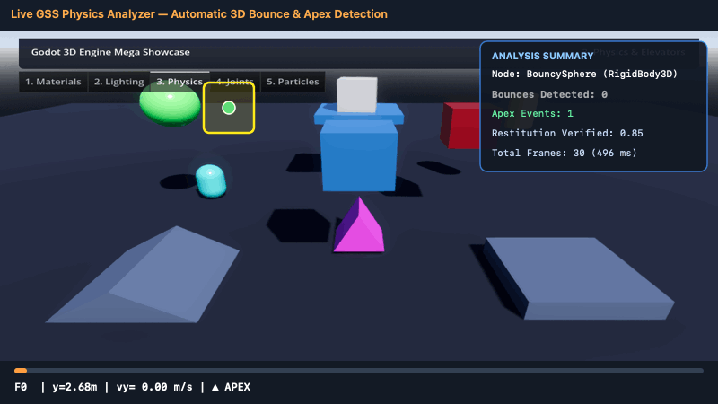

# Godot Scene Snapshot (godot_snapshot)

Godot Scene Snapshot (GSS) lets you take snapshots and recordings of any running Godot 4 scene and inspect them in your web browser.

When you take a snapshot, GSS saves a screenshot along with every node in your scene, where it sits on screen, its physics values, its script variables, and its shader settings. When you record a Live GSS, it tracks how those values change from frame to frame so you can scrub through a bug, a bounce, or an animation step by step.

Everything opens as a normal HTML file in your browser. You do not need a web server.

## What You Can Do

- **Take a Static Snapshot**: Save a screenshot plus a full scene tree, bounding boxes, and shader values (`.png`, `.gss.json`, `.gss.html`).
- **Record a Live Snapshot**: Capture a starting frame and record only what changes on each frame after that (`.gss.live.json`, `.gss.live.html`). It tracks movement paths, bounces, and shader changes.
- **Inspect in Your Browser**: Open any `.gss.html` or `.gss.live.html` file to browse the node tree, click objects on the screenshot, and read their properties and shader uniforms.
- **Use In-Game Hotkeys**: Turn on `GSSOverlay` to press `F9` for a snapshot, `F10` to start or stop a live recording, and `F11` to open the last capture in your browser.
- **Run from the Command Line**: Use `gss_cli.py` to capture, open, or check snapshots from your terminal without writing extra code.

## Quick Start

### Capture from the Terminal

```bash
# Take a screenshot snapshot of demo_2d and open it in your browser
python3 packages/gdtest/tools/gss_cli.py snap demo_2d --open

# Record 60 physics frames of demo_3d and open the timeline player
python3 packages/gdtest/tools/gss_cli.py live demo_3d --frames 60 --open

# Print a quick summary of all captures in a folder
python3 packages/gdtest/tools/gss_cli.py analyze demo_2d
```

### Turn On In-Game Hotkeys (F9 / F10 / F11)

```bash
python3 packages/gdtest/tools/gss_cli.py enable-overlay path/to/your/godot_project
```

### Call from GDScript

```gdscript
# Take a single snapshot
GSS.capture(self, "my_snapshot")

# Record 60 frames
var live_res := await GSS.record_frames(self, 60, "my_recording")
```

## Guides and Walkthrough

- [GSS User Guide (GSS_README.md)](GSS_README.md): Full instructions for capturing, opening, and reading snapshots.
- [Visual Walkthrough Wiki (docs/GODOT_TEST_FRAMEWORK_WIKI.md)](docs/GODOT_TEST_FRAMEWORK_WIKI.md): Step-by-step guide with 12 animated GIFs.

| HTML Inspector and Shaders | Live Physics and Bounce Tracking |
| :---: | :---: |
|  |  |

## What Is in This Repo

- `packages/gdtest/addons/gdtest/core/gss.gd`: Main GSS and Live GSS code, plus the HTML report builder.
- `packages/gdtest/addons/gdtest/core/gss_overlay.gd`: In-game hotkey and toolbar overlay (`F9`, `F10`, `F11`).
- `packages/gdtest/addons/gdtest/core/gss_capture_runner.tscn`: Helper scene used by the command-line tool.
- `packages/gdtest/tools/gss_cli.py`: Command-line tool (`snap`, `live`, `open`, `analyze`, `enable-overlay`).
- `demo_2d/`, `demo_3d/`: Small 2D and 3D example projects.
- `showcase_2d/`, `showcase_3d/`, `showcase_mega/`: Larger example projects covering physics, lighting, shaders, joints, navigation, audio, and UI.

## Running Tests

```bash
# Python CLI tests
python3 -m unittest packages/gdtest/tests/test_gss_cli.py -v

# Godot test suites
python3 packages/gdtest/tools/gdtest_cli.py run packages/gdtest --suite Meta_GSS_Suite
python3 packages/gdtest/tools/gdtest_cli.py run packages/gdtest --suite Meta_GSS_Overlay_Suite
```

## License

MIT. See [packages/gdtest/LICENSE](packages/gdtest/LICENSE).
