# Godot Scene Snapshot (GSS) Walkthrough Wiki

This page walks through how to capture snapshots, record live timelines, inspect shaders, and check your captures using simple examples and animated GIFs.

## Contents

1. [Capturing Static and Live Snapshots](#1-capturing-static-and-live-snapshots)
2. [Using the HTML Inspector and Shader View](#2-using-the-html-inspector-and-shader-view)
3. [Tracking Physics, Joints, and Navigation](#3-tracking-physics-joints-and-navigation)
4. [Example Project Tours](#4-example-project-tours)
5. [Command Line and GDScript Examples](#5-command-line-and-gdscript-examples)

---

## 1. Capturing Static and Live Snapshots

### Taking a Static Snapshot

Press `F9` while playing your game, or run `gss_cli.py snap` from your terminal. GSS saves a screenshot, a JSON file with all node values, and an HTML file you can open in any browser.

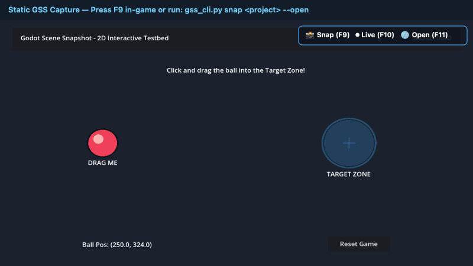

```bash
python3 packages/gdtest/tools/gss_cli.py snap showcase_mega --open
```

### Using the In-Game Hotkeys (F9, F10, F11)

Once you turn on `GSSOverlay`, you get a small toolbar and three shortcuts while playing:
- `F9` takes a screenshot snapshot.
- `F10` starts and stops a live recording.
- `F11` opens your last capture in your browser.

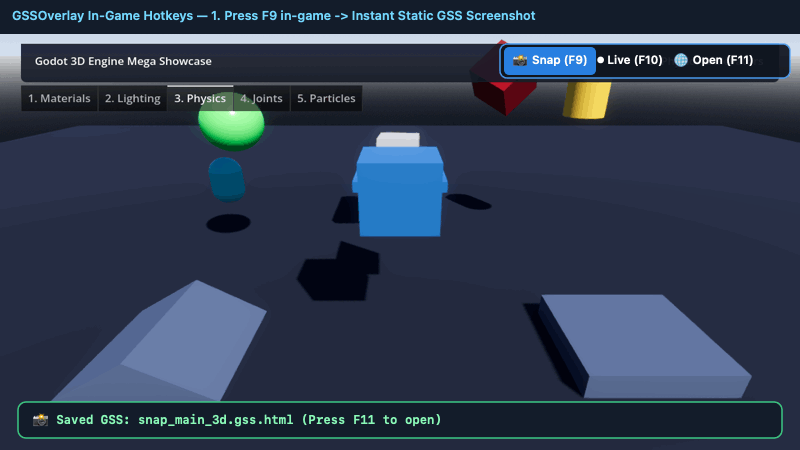

```bash
python3 packages/gdtest/tools/gss_cli.py enable-overlay demo_3d
```

### Recording a Live Timeline

Live GSS saves the first frame in full and then records only what changes on each following frame. When you open the `.gss.live.html` file, you can play it back, step one frame at a time, and see motion paths on screen.

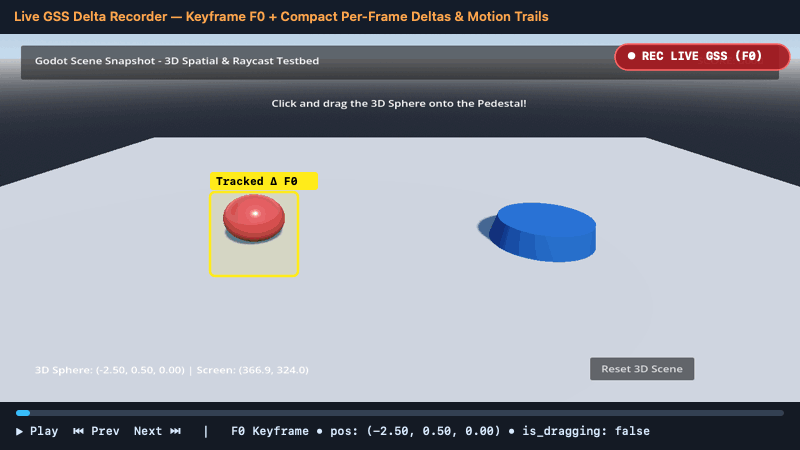

```bash
python3 packages/gdtest/tools/gss_cli.py live demo_3d --frames 60 --open
```

---

## 2. Using the HTML Inspector and Shader View

### Browsing Nodes and Shader Uniforms

Open any `.gss.html` file in your browser to see three panels:
- **Left**: The scene node tree with search.
- **Middle**: The screenshot with clickable boxes around each node.
- **Right**: All properties for the selected node, including shader uniforms and color swatches.

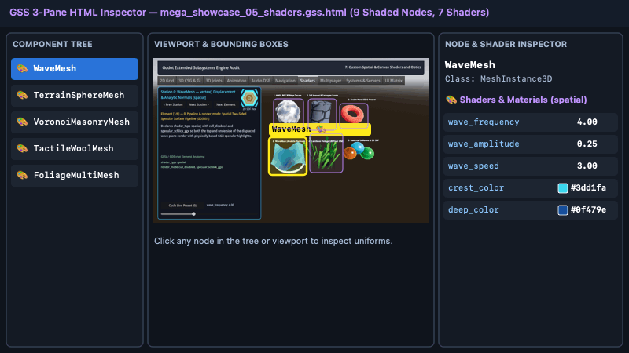

```bash
python3 packages/gdtest/tools/gss_cli.py open showcase_mega
```

### Watching Shader Uniforms Change Over Time

In a Live GSS recording, any shader uniform that changes between frames is highlighted so you can see exactly when and how a material updates.

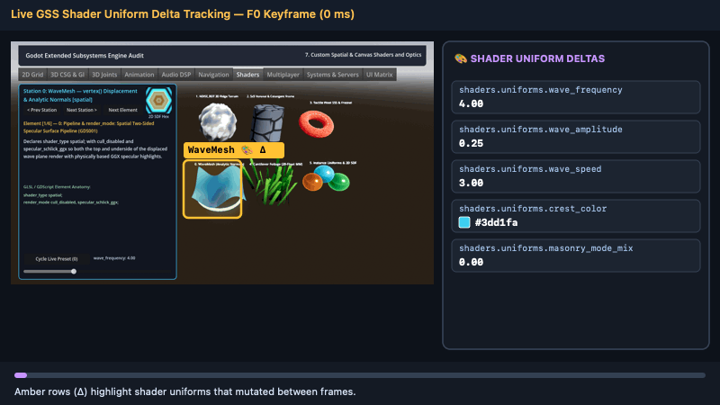

---

## 3. Tracking Physics, Joints, and Navigation

### Physics Bounces and High Points

Live GSS automatically tracks moving bodies, marks where a bounce happens, and finds the highest point of a jump or rebound.

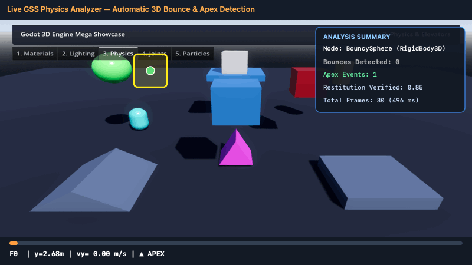

### 3D Joints and Navigation Paths

You can also record mechanical joints (hinges, sliders, pins) and 3D navigation paths around obstacles, with total distance and top speed measured for each moving node.

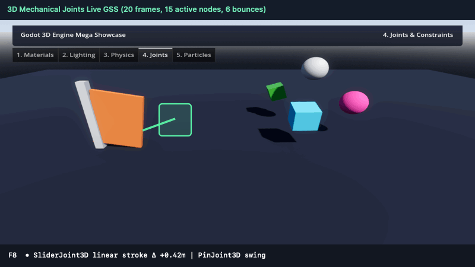

---

## 4. Example Project Tours

### 3D Showcase (`showcase_3d`)

Covers 3D materials, lighting, physics, joints, and particles.

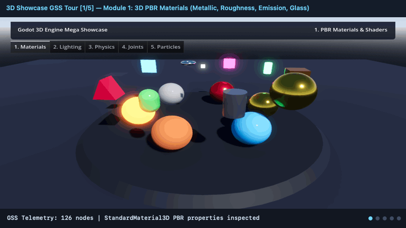

### 2D Showcase (`showcase_2d`)

Covers 2D lights, physics, joints, raycasts, particles, and UI layouts.

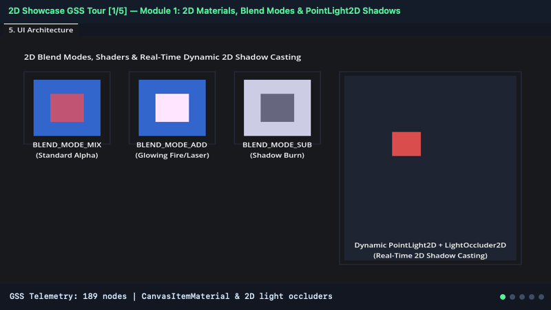

### Full 9-Module Showcase (`showcase_mega`)

Shows GSS running across 2D grids, 3D modeling, audio, navigation, custom shaders, multiplayer, threading, animations, and UI widgets.

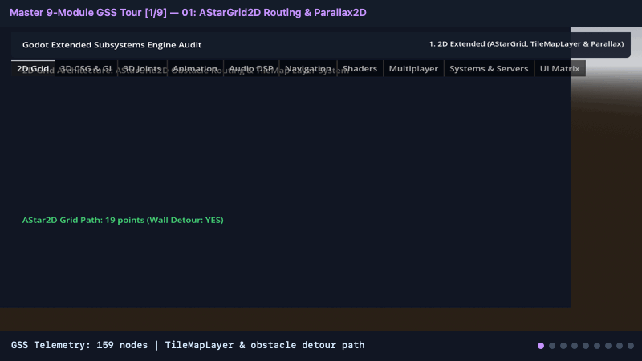

---

## 5. Command Line and GDScript Examples

### Checking Captures from the Terminal

Use `gss_cli.py analyze` to get a quick report of node counts, shaders, moving objects, and bounces without opening a browser.

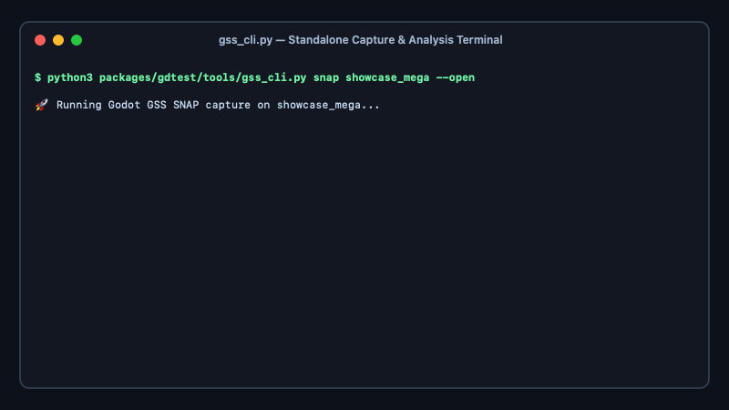

```bash
python3 packages/gdtest/tools/gss_cli.py analyze showcase_mega
python3 packages/gdtest/tools/gss_cli.py analyze showcase_mega --json
```

### Calling GSS from GDScript and Tests

You can capture snapshots, record frames, or jump a live scene back to an earlier recorded frame in just a few lines of GDScript.

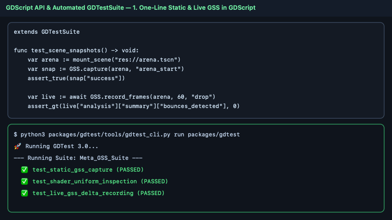

```bash
python3 packages/gdtest/tools/gdtest_cli.py run packages/gdtest --suite Meta_GSS_Suite
python3 packages/gdtest/tools/gdtest_cli.py run packages/gdtest --suite Meta_GSS_Overlay_Suite
```

For full command details and troubleshooting, see [GSS_README.md](../GSS_README.md).
